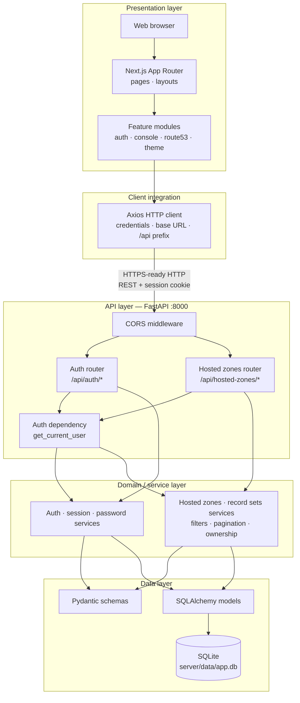

# AWS Route 53 Web Application Clone

Full-stack clone of the **AWS Route 53 Hosted Zones** console. Users can sign up, manage hosted zones and DNS records, and use an AWS Management Console–style UI.

---


## Table of contents

- [Features](#features)
- [Project structure](#project-structure)
- [Architecture](#architecture)
- [Database schema](#database-schema)
- [API reference](#api-reference)
- [Getting started](#getting-started)
- [Environment variables](#environment-variables)
- [Application routes](#application-routes)
- [Notes](#notes)

---

## Features

### Authentication
- Sign up, sign in, sign out
- Passwords hashed with bcrypt
- Session cookie (`httpOnly`)
- Protected console routes
- AWS-style 12-digit `account_id` in the header

### Hosted zones
- Create, list, view, edit, delete
- Public and private zones (VPCs and tags for private)
- Public zone IDs (`Z…`) in URLs and APIs
- Auto-seeded NS and SOA records on create
- Property filters, sorting, pagination, details panel

### DNS records
- Create and delete record sets
- Supported types: A, AAAA, CNAME, MX, TXT, PTR, SRV, SPF, NAPTR, CAA, NS, SOA
- Apex NS/SOA protected from deletion
- Facet and property filters, sorting, pagination

### Console UX
- AWS-style paths under `/route53/v2/...`
- Side navigation, breadcrumbs, header chrome
- Light / dark theme
- Responsive layout

---

## Project structure

```text
Scaler-assignment/
├── client/                      # Next.js application
│   ├── src/app/                 # App Router pages
│   ├── src/features/
│   │   ├── auth/                # Auth UI + API
│   │   ├── console/             # Header, footer, shell
│   │   ├── route53/             # Hosted zones & records
│   │   └── theme/               # Light / dark theme
│   └── src/shared/              # API client, env, icons
├── server/                      # FastAPI application
│   ├── app/
│   │   ├── routers/             # HTTP routes
│   │   ├── services/            # Business logic
│   │   ├── models/              # SQLAlchemy models
│   │   ├── schemas/             # Pydantic schemas
│   │   └── deps/                # Auth dependencies
│   ├── data/                    # SQLite DB (runtime)
│   ├── .env.example
│   └── requirements.txt
└── README.md
```

---

## Architecture

Client–server application: the **Next.js** console UI calls **FastAPI** over REST using an **httpOnly session cookie**. Presentation stays in the client; authorization, ownership, and persistence stay on the server.

### System architecture



### Layer responsibilities

| Layer | Location | Responsibility |
|-------|----------|----------------|
| Presentation | `client/src/app`, `features/` | Console UI, forms, filters, navigation |
| Integration | `client/src/shared/api` | Axios base URL, cookies, API calls |
| API | `server/app/routers`, `deps/` | Routes, validation entry, auth gate |
| Domain | `server/app/services` | Business rules, ownership, pagination |
| Data | `models/`, `schemas/`, SQLite | Persistence and DTO contracts |

### Design notes

- **Session auth** — Sign-in sets an httpOnly cookie; protected routes use `get_current_user`.
- **Tenancy** — Zone and record queries are always scoped to the signed-in user.
- **Public IDs** — Paths use `hosted_zone_id` (`Z…`) and `account_id`; integer PKs remain internal.
- **Modularity** — Feature-sliced frontend and router → service → model backend.

---

## Database schema

```sql
users (
  id            INTEGER PRIMARY KEY,
  account_id    TEXT UNIQUE NOT NULL,
  name          TEXT NOT NULL,
  email         TEXT UNIQUE NOT NULL,
  phone         TEXT UNIQUE NOT NULL,
  password_hash TEXT NOT NULL,
  created_at    TIMESTAMP
);

sessions (
  id         INTEGER PRIMARY KEY,
  user_id    INTEGER NOT NULL REFERENCES users(id) ON DELETE CASCADE,
  token      TEXT UNIQUE NOT NULL,
  expires_at TIMESTAMP NOT NULL,
  created_at TIMESTAMP
);

hosted_zones (
  id              INTEGER PRIMARY KEY,
  user_id         INTEGER NOT NULL REFERENCES users(id) ON DELETE CASCADE,
  hosted_zone_id  TEXT UNIQUE NOT NULL,
  domain_name     TEXT NOT NULL,
  description     TEXT NOT NULL DEFAULT '',
  zone_type       TEXT NOT NULL,              -- public | private
  record_count    INTEGER NOT NULL DEFAULT 2,
  created_by      TEXT NOT NULL,
  vpcs            JSON NOT NULL,
  tags            JSON NOT NULL,
  created_at      TIMESTAMP
);

record_sets (
  id                      INTEGER PRIMARY KEY,
  hosted_zone_id          INTEGER NOT NULL REFERENCES hosted_zones(id) ON DELETE CASCADE,
  record_name             TEXT NOT NULL,
  record_type             TEXT NOT NULL,
  routing_policy          TEXT NOT NULL DEFAULT 'Simple',
  differentiator          TEXT,
  alias                   BOOLEAN NOT NULL DEFAULT FALSE,
  value                   JSON NOT NULL,
  ttl                     INTEGER NOT NULL DEFAULT 300,
  health_check_id         TEXT,
  evaluate_target_health  BOOLEAN NOT NULL DEFAULT FALSE,
  record_id               TEXT,
  created_at              TIMESTAMP
);
```

---

## API reference

Base URL: `http://localhost:8000`  
Prefix: `/api` (except health)  
Docs: [http://localhost:8000/docs](http://localhost:8000/docs)

Auth: session cookie (`session_token` by default). All hosted-zone and record routes require a signed-in user.  
`{hosted_zone_id}` = public zone id (`Z…`), not the integer PK.

### Complete endpoint list

| # | Method | Endpoint | Auth | Description |
|---|--------|----------|------|-------------|
| 1 | GET | `/health` | No | Health check → `{ "status": "ok" }` |
| 2 | POST | `/api/auth/signup` | No | Create account |
| 3 | POST | `/api/auth/signin` | No | Sign in; sets httpOnly session cookie |
| 4 | POST | `/api/auth/signout` | Cookie | Revoke session; clear cookie |
| 5 | GET | `/api/auth/me` | Yes | Current user (`id`, `account_id`, `name`, `email`, `phone`) |
| 6 | POST | `/api/hosted-zones` | Yes | Create hosted zone (auto-seeds NS & SOA) |
| 7 | GET | `/api/hosted-zones` | Yes | List hosted zones (paginated + filters) |
| 8 | GET | `/api/hosted-zones/filter-options` | Yes | Distinct values for zone property filters |
| 9 | GET | `/api/hosted-zones/{hosted_zone_id}/tags` | Yes | List tags for a zone |
| 10 | GET | `/api/hosted-zones/{hosted_zone_id}/record-sets` | Yes | List record sets (paginated + filters) |
| 11 | GET | `/api/hosted-zones/{hosted_zone_id}/record-sets/filter-options` | Yes | Distinct values for record filters |
| 12 | POST | `/api/hosted-zones/{hosted_zone_id}/record-sets` | Yes | Create record set |
| 13 | DELETE | `/api/hosted-zones/{hosted_zone_id}/record-sets/{record_id}` | Yes | Delete record set (`record_id` = integer PK) |
| 14 | GET | `/api/hosted-zones/{hosted_zone_id}` | Yes | Get hosted zone detail |
| 15 | PATCH | `/api/hosted-zones/{hosted_zone_id}` | Yes | Update description / VPCs / tags |
| 16 | DELETE | `/api/hosted-zones/{hosted_zone_id}` | Yes | Delete hosted zone (cascades records) |

**Total: 16 endpoints**

### Query parameters

**`GET /api/hosted-zones`**

| Param | Description |
|-------|-------------|
| `domain_name` | Exact domain name |
| `zone_type` | `public` \| `private` |
| `created_by` | Created by |
| `record_count` | Exact record count |
| `description` | Exact description |
| `hosted_zone_id` | Public zone id (`Z…`) |
| `q` | Free-text search |
| `page` | Page number (default `1`) |
| `page_size` | Page size (default `20`, max `100`) |

**`GET /api/hosted-zones/{hosted_zone_id}/record-sets`**

| Param | Description |
|-------|-------------|
| `type` | Record type (A, CNAME, …) |
| `routing_policy` | Routing policy |
| `alias` | Alias filter (`Yes` / `No`, etc.) |
| `record_name` | Exact record name |
| `differentiator` | Differentiator |
| `value` | Value substring |
| `ttl` | Exact TTL |
| `health_check_id` | Health check id |
| `evaluate_target_health` | Target health flag |
| `record_id` | Record id string field |
| `q` | Free-text search |
| `page` | Page number (default `1`) |
| `page_size` | Page size (default `20`, max `100`) |

### Paginated response shape

Used by `GET /api/hosted-zones` and `GET /api/hosted-zones/{hosted_zone_id}/record-sets`:

```json
{
  "items": [],
  "page": 1,
  "page_size": 20,
  "total": 0,
  "total_pages": 0
}
```

---

## Getting started

### Prerequisites

- Node.js 20+
- Python 3.11+
- npm

### 1. Backend

```bash
cd server
python -m venv venv

# Windows
venv\Scripts\activate
# macOS / Linux
# source venv/bin/activate

pip install -r requirements.txt
copy .env.example .env
# macOS / Linux: cp .env.example .env

uvicorn app.main:app --reload --port 8000
```

- API: http://localhost:8000  
- Docs: http://localhost:8000/docs  

### 2. Frontend

```bash
cd client
npm install
copy .env.example .env.local
# macOS / Linux: cp .env.example .env.local

npm run dev
```

- App: http://localhost:3000  

Create an account, sign in, then open hosted zones.

---

## Environment variables

### Client — `client/.env.local`

| Variable | Description | Example |
|----------|-------------|---------|
| `NEXT_PUBLIC_API_URL` | Backend origin | `http://localhost:8000` |
| `NEXT_PUBLIC_API_PREFIX` | API prefix | `/api` |
| `NEXT_PUBLIC_AFTER_AUTH_PATH` | Post-login path | `/route53/v2/hostedzones` |
| `NEXT_PUBLIC_LOGIN_PATH` | Login path | `/` |

See `client/.env.example`.

### Server — `server/.env`

| Variable | Description | Example |
|----------|-------------|---------|
| `DATABASE_URL` | SQLAlchemy database URL | `sqlite:///./data/app.db` |
| `CORS_ORIGINS` | Allowed origins | `http://localhost:3000` |
| `SESSION_COOKIE_NAME` | Cookie name | `session_token` |
| `SESSION_MAX_AGE_SECONDS` | Session lifetime | `604800` |
| `COOKIE_SECURE` | HTTPS-only cookie | `false` (local) |
| `COOKIE_SAMESITE` | SameSite policy | `lax` |
| `PASSWORD_MIN_LENGTH` | Min password length | `8` |

See `server/.env.example`.

SQLite is stored under `server/data/` so data persists across API restarts.

---

## Application routes

| Page | Path |
|------|------|
| Sign in / Sign up | `/` |
| Hosted zones | `/route53/v2/hostedzones` |
| Create hosted zone | `/route53/v2/hostedzones/create` |
| Zone detail | `/route53/v2/hostedzones/{HostedZoneId}` |
| Edit zone | `/route53/v2/hostedzones/{HostedZoneId}/edit` |
| Create record | `/route53/v2/hostedzones/{HostedZoneId}/create-record` |

---
live demo link - https://route53-gamma.vercel.app/

## Notes

- All hosted zone and record operations are scoped to the authenticated user.
- Public `hosted_zone_id` values (`Z…`) are used in UI and API paths.
- This project is for educational / assignment use and is not affiliated with Amazon Web Services.
